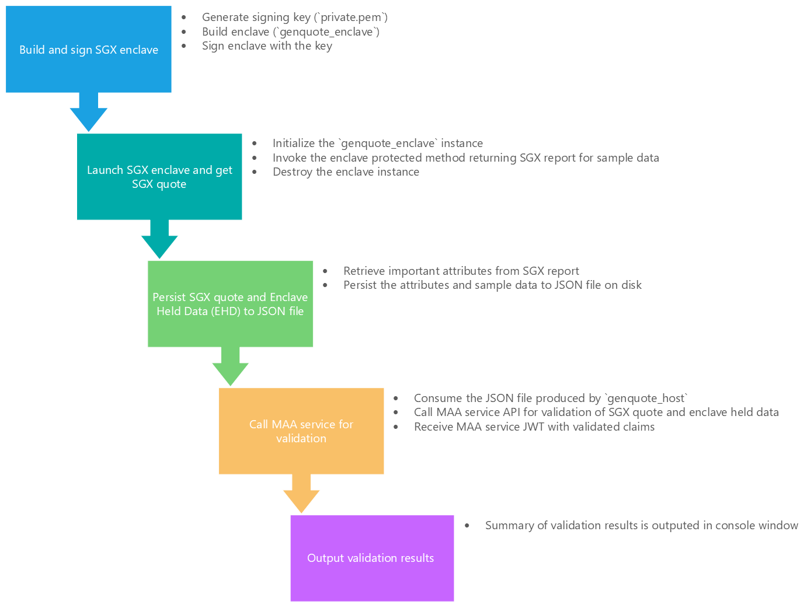

## Sample code for Intel® SGX Attestation using Microsoft Azure Attestation service and Intel® SGX SDK for Linux OS

### References
* The sample, including code, design and documentation, is derived from the [Sample code for Intel® SGX Attestation using Microsoft Azure Attestation and Open Enclave SDK for Linux OS](../sgx.attest.sample.oe.sdk) and follows its execution flow
* The SGX enclave and host code in this sample is derived from the [Intel® Software Guard Extensions Data Center Attestation Primitives (Intel® SGX DCAP) Quote Generation SampleCode](https://github.com/intel/SGXDataCenterAttestationPrimitives/tree/master/SampleCode/QuoteGenerationSample)
* Intel® Software Guard Extensions (Intel® SGX) Data Center Attestation Primitives (Intel® SGX DCAP): https://github.com/intel/SGXDataCenterAttestationPrimitives
* Intel® Software Guard Extensions for Linux* OS: https://github.com/intel/linux-sgx

### Overview

The Azure Attestation SGX sample code demonstrates how to generate a quote in an SGX enclave and then get it validated by the Microsoft Azure Attestation (MAA) service. The "enclave held data" for the quote for simplicity is populated with sample data represented as `uint8_t` array.

The execution flow in the sample code are outlined in the following diagram:



The flow is:
1. ```genquote_enclave``` - This application is an SGX enclave created via the Intel® SGX SDK. It exposes one ECALL that creates an SGX report for the enclave held data, targeted at the Intel quoting enclave.
    1. Generate signing key (`private.pem`)
    1. Build enclave (`genquote_enclave`)
    1. Sign enclave with the key
1. ```genquote_sgx_host``` - This application is run first and performs the following:
    1. Initializes and launches the `genquote_enclave` SGX enclave instance
    1. Invokes the enclave protected method (ECALL) to create an SGX report over the hashed (SHA256) enclave held data, which in this case is a `uint8_t` static array, and gets a remote quote for that report from the Intel quoting enclave (`sgx_qe_get_quote`)
    1. Retrieves important attributes from the SGX report, such as Security Version Number, ProductID, MRSIGNER, MRENCLAVE, etc.
    1. Persists the remote quote, enclave held data and parsed report fields to a JSON file on disk
1. ```validatequotes.core``` - This is a .NET 10 console application. It doesn't need SGX hardware and runs on the operating systems supported by .NET 10, such as Windows, Linux and macOS. It consumes the JSON file persisted by the ```genquote_sgx_host``` application and performs the following:
    1. Calls the Azure Attestation service for validation, passing it the remote quote and enclave held data found in the JSON file
    1. Validates that the Azure Attestation JWT passes signature validation and is issued by the expected party
    1. Validates that the Azure Attestation JWT claim values match the parsed data in the JSON file for the well known fields like Security Version Number, ProductID, MRSIGNER, MRENCLAVE, etc.
    1. Produces a report in the console with the results

### Quote Generation

Remote quote generation is a two-step process. First, the enclave creates an SGX report over the enclave held data, targeted at the Intel quoting enclave, by the following call to the ```sgx_create_report``` method in the [ecalls.cpp](./genquotes/enclave/ecalls.cpp#L11) file in the ```genquote_enclave``` application:

```
return sgx_create_report(p_qe3_target, p_data, p_report);
```

Then the host gets the remote quote for that report from the Intel quoting enclave by the following call to the ```sgx_qe_get_quote``` method in the [host.cpp](./genquotes/host/host.cpp#L131) file in the ```genquote_sgx_host``` application:

```
qe3_ret = sgx_qe_get_quote(&app_report,
                           quote_size,
                           p_quote_buffer);
```

### Remote Quote Validation via MAA Attestation

The MAA service is called through the Azure Attestation client library (`Azure.Security.Attestation`) by the following call in the [Program.cs](./validatequotes.core/Program.cs#L80) file:

```
    var serviceResponse = await maaService.AttestSgxEnclaveAsync(
        new AttestationRequest
        {
            Evidence = sgxEnclaveReport,
            RuntimeData = new AttestationData(runtimeData, false),
        });
```

The client is created with `DefaultAzureCredential` ([Program.cs](./validatequotes.core/Program.cs#L74)), so you must be signed in to Azure, for example with `az login`, before running the application.

The client library validates the MAA service JWT signature and issuer. The sample's additional checks of the token signing certificate issuer and the issuer claim are in the [JwtValidationHelper.cs](./validatequotes.core/Helpers/JwtValidationHelper.cs#L13) file:
```
    public static bool ValidateMaaJwt(string attestDnsName, AttestationToken serviceToken, AttestationSigner tokenSigner, bool includeDetails)
```

The verification that the MAA service JWT claims match the initial parsed report data is performed in the [EnclaveInfo.cs](./validatequotes.core/EnclaveInfo.cs#L24) file:
```
    public void CompareToMaaServiceJwtToken(AttestationResult serviceResult, bool includeDetails)
```

## How to Build and Run

## Prerequisites/System setup
1. Create an [Azure Confidential Computing](https://azure.microsoft.com/en-us/solutions/confidential-compute/) Ubuntu 22.04 VM with Intel SGX.
2. Install the Intel SGX SDK and SGX libraries. See https://download.01.org/intel-sgx/sgx-dcap (for example, https://download.01.org/intel-sgx/sgx-dcap/1.27.1/linux/distro/ubuntu22.04-server/) for the latest SDK files. Ubuntu 22.04 kernels include the SGX driver, so no separate driver installation is needed.

Configure the Intel and Microsoft APT Repositories. Each key is trusted only for its own repository (`signed-by`):
```
sudo install -d -m 0755 /etc/apt/keyrings
wget -qO - https://download.01.org/intel-sgx/sgx_repo/ubuntu/intel-sgx-deb.key | sudo gpg --dearmor -o /etc/apt/keyrings/intel-sgx.gpg
echo 'deb [arch=amd64 signed-by=/etc/apt/keyrings/intel-sgx.gpg] https://download.01.org/intel-sgx/sgx_repo/ubuntu jammy main' | sudo tee /etc/apt/sources.list.d/intel-sgx.list
wget -qO - https://packages.microsoft.com/keys/microsoft.asc | sudo gpg --dearmor -o /etc/apt/keyrings/microsoft.gpg
echo 'deb [arch=amd64 signed-by=/etc/apt/keyrings/microsoft.gpg] https://packages.microsoft.com/ubuntu/22.04/prod jammy main' | sudo tee /etc/apt/sources.list.d/msprod.list
```

Install SGX libraries and the build tools (the SDK installer needs `make`):
```
sudo apt update
sudo apt install -y build-essential libssl-dev libsgx-quote-ex libsgx-enclave-common libsgx-enclave-common-dev libsgx-dcap-ql libsgx-dcap-ql-dev az-dcap-client
```

Install Intel SGX SDK. The installer runs only if its SHA-256 matches the value Intel publishes in [SHA256SUM_dcap_1.27.1.cfg](https://download.01.org/intel-sgx/sgx-dcap/1.27.1/linux/SHA256SUM_dcap_1.27.1.cfg):
```
wget https://download.01.org/intel-sgx/sgx-dcap/1.27.1/linux/distro/ubuntu22.04-server/sgx_linux_x64_sdk_2.30.101.1.bin -O sgx_linux_x64_sdk.bin
echo "9a2575ea9c2ae23382488d7bb3f1209155b5e4e4a93cb792a6b5a3f86f4a7e6c  sgx_linux_x64_sdk.bin" | sha256sum -c - && chmod a+x sgx_linux_x64_sdk.bin && sudo ./sgx_linux_x64_sdk.bin
```

Specify a directory to install the Intel SGX SDK. For example, `/opt/intel`
If the SDK is installed into /opt/intel, run the following command:
```
echo "source /opt/intel/sgxsdk/environment" >> ~/.bashrc && source ~/.bashrc
```
For more information see: https://github.com/intel/linux-sgx

3. Install the [.NET 10.0 SDK](https://learn.microsoft.com/dotnet/core/install/linux-ubuntu-install?tabs=dotnet10&pivots=os-linux-ubuntu-2204) on this VM. On Ubuntu 22.04, .NET 10 is available from the Ubuntu .NET backports package repository:

```
sudo add-apt-repository ppa:dotnet/backports
sudo apt update && sudo apt install -y dotnet-sdk-10.0
```

4. Install the [Azure CLI](https://learn.microsoft.com/cli/azure/install-azure-cli-linux) and sign in with `az login`. `validatequotes.core` uses these credentials to call the MAA service.

## Build and Run
1. Clone MAA samples repo to the VM:

```
git clone --recursive https://github.com/Azure-Samples/microsoft-azure-attestation.git
```

OR

```
git clone --recursive --branch <branch-name> https://github.com/Azure-Samples/microsoft-azure-attestation.git
```

OR

```
git clone --recursive git@github.com:Azure-Samples/microsoft-azure-attestation.git

```

2. Change the directory:

```
cd ./microsoft-azure-attestation/sgx.attest.sample.intel.sdk
```

3. Build, run and generate the JSON files do the following:

```
cd genquotes
```

```
sudo ./runall.sh
```

This runs the application in four different enclave configurations to generate four different remote quotes.  The four JSON files are written to the ```genquotes/out``` directory, replacing the example quotes.

4. Build, run and validate the JSON files with the MAA service do the following:

```
cd ../validatequotes.core
```

```
./runall.sh
```

These steps build and run the validation application against the four different JSON files produced earlier.

##### The four different JSON files are:
* *enclave.info.debug.json* - debugging enabled
* *enclave.info.release.json* - debugging disabled
* *enclave.info.securityversion.json* - security version set to 8888
* *enclave.info.prodid.json* - product id set to 9999

## Example Output for ./runall.sh
Here is an example of the output of ```./runall.sh``` for the first JSON file. The same checks are repeated for the other three files:

```
[17:13:35.435] :
[17:13:35.462] : ************************************************************************************************************************
[17:13:35.462] : *      PARAMETERS FOR THIS RUN
[17:13:35.462] : ************************************************************************************************************************
[17:13:35.462] : Validating filename                : ../genquotes/out/enclave.info.debug.json
[17:13:35.462] : Using attestation provider         : sharedcus.cus.attest.azure.net
[17:13:35.462] : Including details                  : False
[17:13:48.453] :
[17:13:48.453] : ************************************************************************************************************************
[17:13:48.453] : *      IN VALIDATION CALLBACK, VALIDATING MAA JWT TOKEN - BASICS
[17:13:48.453] : ************************************************************************************************************************
[17:13:48.460] : JWT issuer claim validation        : True
[17:13:48.461] : JWT signing cert issuer validation : True
[17:13:48.462] :
[17:13:48.462] : ************************************************************************************************************************
[17:13:48.462] : *      SAVING JWT TOKEN as `maa-jwt-token.txt`
[17:13:48.462] : ************************************************************************************************************************
[17:13:48.465] :
[17:13:48.465] : ************************************************************************************************************************
[17:13:48.465] : *      VALIDATING MAA JWT TOKEN - MATCHES CLIENT ENCLAVE INFO
[17:13:48.465] : ************************************************************************************************************************
[17:13:48.467] : IsDebuggable match                 : True
[17:13:48.467] : MRENCLAVE match                    : True
[17:13:48.467] : MRSIGNER match                     : True
[17:13:48.467] : ProductID match                    : True
[17:13:48.468] : Security Version match             : True
[17:13:48.468] : Enclave Held Data match            : True
[17:13:48.468] :
...
```
