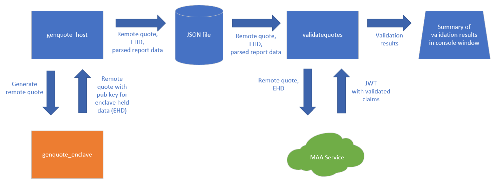

---
page_type: sample
languages:
- c
- csharp
products:
  - azure
description: "Learn how to perform Intel® SGX Attestation using Microsoft Azure Attestation and Open Enclave SDK."
--- 

# Sample code for Intel® SGX Attestation using Microsoft Azure Attestation and Open Enclave SDK for Linux OS

Intel® SGX Attestation sample code demonstrates how to generate a quote from an SGX enclave using Open Enclave SDK and then get it validated by Microsoft Azure Attestation. The "enclave held data" for the quote is populated with public key component of a 2048 bit RSA key that's held within the enclave.

The components used in the sample code are outlined in the following diagram:


The flow is:
1. ```genquote_host``` - This application is run first and performs the following:
    1. Launches the ```genquote_enclave``` SGX enclave
    1. Calls into the enclave (via an ecall) to retrieve a remote quote and a copy of the enclave held data, which in this case is the public key for a 2048 bit RSA key
    1. Calls into the Open Enclave SDK to parse the remote quote to retrieve important attributes like Security Version Number, ProductID, MRSIGNER, MRENCLAVE, etc.
    1. Persists the remote quote, enclave held data and parsed report fields to a JSON file on disk
1. ```genquote_enclave``` - This application is an SGX enclave created via the Open Enclave SDK.  It exposes one ecall to retrieve a remote quote and enclave held data.
1. ```validatequotes.core``` - This application is built on .NET and runs on any platform.  It consumes the JSON file persisted by the ```genquote_host``` application and performs the following:
    1. Calls the Azure Attestation for validation, passing it the remote quote and enclave held data found in the JSON file
    1. Validates that the Azure Attestation JWT passes signature validation and is issued by the expected party
    1. Validates that the Azure Attestation JWT claim values match the parsed data in the JSON file for the well known fields like Security Version Number, ProductID, MRSIGNER, MRENCLAVE, etc.
    1. Produces a report in the console with the results


## Remote Quote Generation
*Note: The SGX enclave code in this sample is derived from the [remote_attestation sample code](https://github.com/openenclave/openenclave/tree/master/samples/remote_attestation) in Open Enclave SDK.  Many thanks to the author(s)!*

Remote quote generation is performed by the following call to the ```oe_get_report``` method in the [attestation.cpp](genquotes/common/attestation.cpp#L43) file in the ```genquote_enclave``` application.
```
result = oe_get_report(
    OE_REPORT_FLAGS_REMOTE_ATTESTATION,
    sha256,
    sizeof(sha256),
    NULL, 
    0,
    &temp_buf,
    remote_report_buf_size);
```

## Remote Quote Validation via Azure Attestation

Azure Attestation is called through the Azure Attestation client library (`Azure.Security.Attestation`) by the following call in the [Program.cs](validatequotes.core/Program.cs#L79) file:

```
var serviceResponse = await maaService.AttestOpenEnclaveAsync(
    new AttestationRequest
    {
        Evidence = openEnclaveReport,
        RuntimeData = new AttestationData(runtimeData, false),
    });
```

The client is created with `DefaultAzureCredential` ([Program.cs](validatequotes.core/Program.cs#L73)), so you must be signed in to Azure, for example with `az login`, before running the application.

The client library validates the Azure Attestation JWT signature and issuer. The sample's additional checks of the token signing certificate issuer and the issuer claim are in the [JwtValidationHelper.cs](validatequotes.core/Helpers/JwtValidationHelper.cs#L13) file:
```
public static bool ValidateMaaJwt(string attestDnsName, AttestationToken serviceToken, AttestationSigner tokenSigner, bool includeDetails)
```

The verification that the Azure Attestation JWT claims match the initial parsed report data is performed in the [EnclaveInfo.cs](validatequotes.core/EnclaveInfo.cs#L24) file:
```
public void CompareToMaaServiceJwtToken(AttestationResult serviceResult, bool includeDetails)
```

## About the Enclave Signing Key

The build signs the sample enclave with `oesign` using a 3072-bit RSA key pair. The key pair is not part of the repository: the first `make build` generates `genquotes/enclave/private.pem` and `genquotes/enclave/public.pem` with OpenSSL. Both files are listed in [.gitignore](.gitignore).

* The signing key determines the enclave's signer identity, **MRSIGNER**, so your build reports your own MRSIGNER.
* Keep `private.pem` private and never commit it. Anyone who has it can sign an enclave that reports your MRSIGNER.
* `make clean` deletes the key pair. The next `make build` generates a new pair, so MRSIGNER changes. Back up `private.pem` if you need a stable MRSIGNER across builds.
* For production enclaves, protect the signing key, for example in an HSM, instead of keeping it next to the build.

The example quotes in [genquotes/quotes](genquotes/quotes) were generated on Azure SGX hardware with an earlier demo signing key that used to be committed to this repository. That key has been retired. Because it was public, **never trust its MRSIGNER** (`62ba6bcab59700c340bdbcd36bf74c6e0d6892cdf91671dca93bcbfff81ef9f2`) in an attestation policy or relying party. The example quotes still validate as-is: `validatequotes.core` compares the Azure Attestation claims with the values recorded in each JSON file.

The debug configuration (`enc.conf`, `Debug=1`) produces a debuggable enclave: a debugger on the host can read and modify its memory. Azure Attestation reports this as `x-ms-sgx-is-debuggable: true`; production policies should reject it.

## Instructions to Build and Run Yourself

To set up the pre-requisites to build and run these samples:
1. Create an Ubuntu 20.04 VM with Intel SGX from [Azure Confidential Compute](https://azure.microsoft.com/en-us/solutions/confidential-compute/).
1. Install the [Open Enclave SDK](https://github.com/openenclave/openenclave/blob/master/docs/GettingStartedDocs/install_oe_sdk-Ubuntu_20.04.md) on this VM.  You don't need to install Ninja or CMake -- they are not used here.
1. Add the command "```. /opt/openenclave/share/openenclave/openenclaverc```" to your ~/.bashrc file.
1. Install the [.NET 8.0 SDK](https://dotnet.microsoft.com/en-us/download/dotnet/8.0) on this VM. The Open Enclave SDK installation already adds the Microsoft package repository, so run:
    1. `sudo apt update && sudo apt install -y dotnet-sdk-8.0`
1. Install the [Azure CLI](https://learn.microsoft.com/cli/azure/install-azure-cli-linux) and sign in with `az login`. `validatequotes.core` uses these credentials to call Azure Attestation.

To build and run the samples:
1. ```git clone https://github.com/Azure-Samples/microsoft-azure-attestation``` to the VM
1. ```cd microsoft-azure-attestation/sgx.attest.sample.oe.sdk```
1. To build, run and generate the JSON files do the following:
    1. ```cd genquotes```
    1. ```make build```. The first build generates the enclave signing key; see [About the Enclave Signing Key](#about-the-enclave-signing-key).
    1. ```sudo make run```
    1. This runs the application in four different enclave configurations to generate four different remote quotes.  The four JSON files are written to the ```genquotes/quotes``` directory, replacing the example quotes.
1. To build, run and validate the JSON files with Azure Attestation do the following:
    1. ```cd ../validatequotes.core```
    1. ```./runall.sh```
    1. This builds and runs the validation application against the four different JSON files produced earlier.

The four different JSON files are:
* *enclave.info.debug.json* - debugging enabled
* *enclave.info.release.json* - debugging disabled
* *enclave.info.securityversion.json* - security version set to 8888
* *enclave.info.prodid.json* - product id set to 9999

## Example Output for make run
Here is an example of what the output of ```make run``` should look like:

```
user@sgxvm:~/microsoft-azure-attestation/sgx.attest.sample.oe.sdk/genquotes$ sudo make run
host/genquote_host ./enclave/genquote_enclave.debug.signed              enclave.info.debug.json
    JSON file created: enclave.info.debug.json
host/genquote_host ./enclave/genquote_enclave.release.signed            enclave.info.release.json
    JSON file created: enclave.info.release.json
host/genquote_host ./enclave/genquote_enclave.prodid.signed             enclave.info.prodid.json
    JSON file created: enclave.info.prodid.json
host/genquote_host ./enclave/genquote_enclave.securityversion.signed    enclave.info.securityversion.json
    JSON file created: enclave.info.securityversion.json
```

## Example Output for ./runall.sh
Here is an example of the output of ```./runall.sh``` for the first JSON file. The same checks are repeated for the other three files:

```
user@sgxvm:~/microsoft-azure-attestation/sgx.attest.sample.oe.sdk/validatequotes.core$ ./runall.sh
[13:44:08.747] : 
[13:44:08.779] : ************************************************************************************************************************
[13:44:08.779] : *      PARAMETERS FOR THIS RUN
[13:44:08.779] : ************************************************************************************************************************
[13:44:08.779] : Validating filename                : ../genquotes/quotes/enclave.info.debug.json
[13:44:08.779] : Using attestation provider         : sharedcus.cus.attest.azure.net
[13:44:08.779] : Including details                  : False
[13:44:25.932] : 
[13:44:25.932] : ************************************************************************************************************************
[13:44:25.932] : *      IN VALIDATION CALLBACK, VALIDATING MAA JWT TOKEN - BASICS
[13:44:25.932] : ************************************************************************************************************************
[13:44:25.950] : JWT issuer claim validation        : True
[13:44:25.951] : JWT signing cert issuer validation : True
[13:44:25.952] : 
[13:44:25.952] : ************************************************************************************************************************
[13:44:25.952] : *      VALIDATING MAA JWT TOKEN - MATCHES CLIENT ENCLAVE INFO
[13:44:25.952] : ************************************************************************************************************************
[13:44:25.955] : IsDebuggable match                 : True
[13:44:25.955] : MRENCLAVE match                    : True
[13:44:25.955] : MRSIGNER match                     : True
[13:44:25.956] : ProductID match                    : True
[13:44:25.957] : Security Version match             : True
[13:44:25.957] : Enclave Held Data match            : True
...
```
